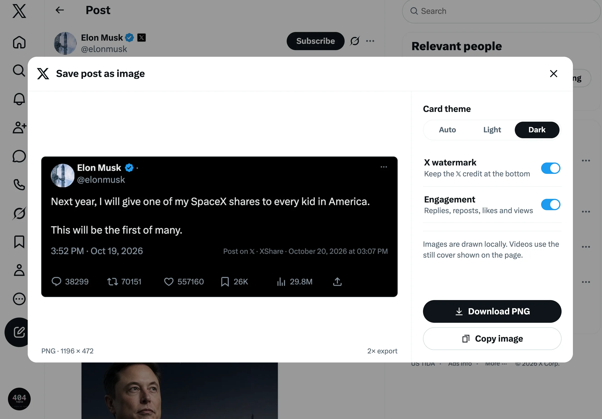

# XShare

一个把 X（Twitter）帖子保存为高清 PNG 的 Chrome 扩展。它不会截屏，而是读取当前帖子，用 X 的排版比例重新绘制成一张干净的图片。



## 功能

- 在 X 的帖子分享菜单中加入 **保存帖子为图片**。
- 复刻时间线和帖子详情两种版式，包括头像、认证标识、正文、引用、媒体与互动数据。
- 支持浅色、深色和跟随页面主题，默认以 2× 分辨率导出。
- 可以搜索并多选本机已安装的字体来绘制卡片，按选择顺序 1、2、3… 依次回退，最后回退到 X 的字体。
- 可以直接下载 PNG，也可以复制到剪贴板。
- 自动展开长帖，并保留当前可见的图片、视频封面和引用内容。
- 界面与 X 页面保持同一种语言，支持 10 种语言。
- 所有内容都在浏览器本地处理，不上传帖子或浏览数据。字体列表通过 `fontSettings` 权限只读取字体名称，不读取字体文件。

## 效果

时间线版式：


帖子详情版式：


时间线卡片的分享署名位于互动栏上方；详情卡片会优先把署名放在发布时间右侧，空间不足时自动换行。署名内容为 `Post on 𝕏 · XShare · 分享时间`。

## 安装

### 下载安装包

[下载最新版 XShare](https://github.com/elonnzhang/XShare/releases/latest)

1. 下载并解压 `XShare-v*.zip`。
2. 打开 `chrome://extensions/` 并进入开发者模式。
3. 点击 **加载已解压的扩展程序**，选择解压后的目录。
4. 打开或刷新 `https://x.com/`。

### 从源码安装

1. 打开 Chrome，进入 `chrome://extensions/`。
2. 打开右上角的 **开发者模式**。
3. 点击 **加载已解压的扩展程序**，选择本仓库目录。
4. 打开或刷新 `https://x.com/`。

### 安装构建目录

仓库包含已经构建好的 `dist/`，也可以在第 3 步直接选择 `dist/`。

## 使用

1. 点击任意帖子下方的分享按钮。
2. 选择 **保存帖子为图片**。
3. 在预览弹窗中选择卡片主题。
4. 点击 **下载 PNG** 或 **复制图片**。

点击 Chrome 工具栏中的 XShare 图标可以设置默认主题、X 署名和互动数据。视频和 GIF 会使用页面上可见的静态封面。

## 多语言

界面语言跟随 X 网站的 `<html lang>`。切换 X 的语言后，新打开的菜单、预览弹窗、提示消息和工具栏弹窗会同步切换。

- 支持：English、简体中文、繁體中文、日本語、한국어、Español、Français、Deutsch、Português、Русский。
- 其他语言回退到英文。
- 扩展名称和描述通过 `_locales/` 按浏览器语言显示。

新增语言时，需要同时更新 `shared/i18n.js` 的 `SUPPORTED`、`MESSAGES` 和 `_locales/` 下对应的 `messages.json`。

## 开发

项目没有第三方运行时依赖。构建和校验需要 Node.js 20 或更高版本。

```bash
# 重新生成 dist/（只包含扩展运行所需文件）
node scripts/build.mjs

# 生成可上传到 GitHub Releases 的安装包与 SHA-256 校验文件
node scripts/package.mjs

# 检查 JS、JSON、多语言文案、Manifest 引用和 dist/ 是否同步
node scripts/check.mjs
```

不要直接修改 `dist/`。修改源码后重新运行构建，并把 `dist/` 的变化一起提交。GitHub Actions 会在每次推送和 PR 时运行同一套校验。

## 目录

```text
XShare/
├── .github/workflows/    # CI 校验
├── _locales/             # Chrome 扩展名称与描述
├── content/              # 分享菜单注入、帖子读取与 Canvas 绘制
├── docs/                 # README 截图
├── icons/                # 扩展图标
├── popup/                # 工具栏设置弹窗
├── scripts/              # 构建与校验脚本
├── shared/i18n.js        # 页面与弹窗共用的多语言文案
├── dist/                 # 可直接加载的构建产物
├── background.js         # 下载与安装初始化
└── manifest.json         # Manifest V3 配置
```

## 权限与隐私

- `downloads`：保存生成后的 PNG。
- `storage`：保存主题、署名和互动数据偏好。
- `clipboardWrite`：把图片复制到剪贴板。
- `x.com`、`twitter.com` 和 `pbs.twimg.com`：读取帖子内容、头像和媒体，并注入分享菜单。

扩展不包含远程代码，也不会把帖子、头像、图片或浏览数据发送到第三方服务。

## 已知限制

- X 的页面结构变化可能导致帖子解析失效，需要更新选择器。
- 视频和 GIF 只能导出页面上显示的静态封面。
- 被 X 限制访问的内容无法导出。
